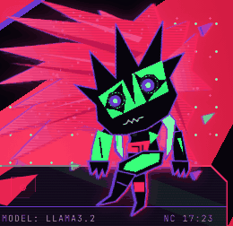
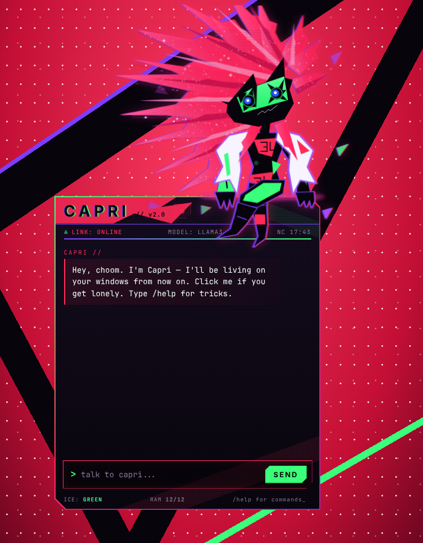

# CAPRI // desktop AI companion

A fan-made desktop AI assistant themed on **Capri** from *Cyberpunk: Edgerunners 2*. She has a huge
windswept, glittering red-pink mane, tall black blade spikes, and a green visor split by a black
spike. Her blue eyes have white cores and sit in star-shaped black sockets. She has a tiny zigzag
mouth that snaps into a white triangle grin, a white jacket with violet rims, and red circuit
patches. She sits near the top-right corner of her chat window with her legs crossed. Detach her
and she sits on top of any window on your screen, follows your cursor with her eyes, and talks
back out loud.





> Unofficial fan project, not affiliated with CD PROJEKT RED or Studio Trigger.

## Run it

```bash
cd capri
npm install
npm start
```

### Give her a brain (optional, free, offline)

Capri talks through a local model with [Ollama](https://ollama.com). Nothing leaves your machine and you don't need an API key.

```bash
ollama pull llama3.2
```

Leave Ollama running and Capri finds it at `http://127.0.0.1:11434` and picks a model by
herself. If Ollama isn't running, she falls back to built-in replies: chit-chat, time and date,
jokes, and a calculator (`what is (2+3)*4^2`). You can change the endpoint, model and your
handle in **⚙ settings**.

## Things to try

| | |
|---|---|
| **⇱** or `Ctrl+Shift+Space` | **Perch mode**: hides the chat and leaves Capri on your desktop, always on top |
| Drag her (chat window) | Slide her along the window's top edge. Her spot is remembered |
| Drag her (perch mode) | Drop her on the edge of any window. Drop her near the bottom of the screen and she snaps onto the taskbar |
| Click her | Opens the chat in perch mode. In the chat window it pokes her |
| Right-click her | Menu: open chat / sit on taskbar / quit |
| `/help` | Commands: `/clear`, `/perch`, `/sleep`, `/model <name>`, `/link` |
| ⚙ → **Voice** | Turn her voice on or off, pick a voice, and set pitch, speed and data chirps. **CAPRI PRESET** resets it |
| ⚙ → **Skin** | Load your own Capri GIF/PNG/WebM to replace the drawn version |

## How she's animated

- **Line boil:** every shard flips between hand-jittered copies of itself at about 8 fps, like the show's limited animation.
- **Always on:** each hair strand flutters in the wind, the stars in her hair twinkle, and purple and green glitch shards drift past. Her crossed top foot bobs, and she breathes, blinks (sometimes twice), flickers, and has RGB-split edges. Her eyes and head track your cursor anywhere on screen.
- **Moods:** *thinking* (shards float, eyes roll up, head sways), *talking* (the grin snaps open and shut, body bobs, legs kick faster, hair whips), *happy* (^^ eyes plus the big grin), *asleep* after 90 s idle (head droops, zzz, everything stills).
- **Random idle actions:** hair tosses, foot kicks, glitch bursts, head tilts, leaning forward, spike shivers, and eye glances.
- **Glitch-in** entrance when she appears, and flailing legs while you drag her.

### Voice

Capri reads her replies aloud with your system's built-in text-to-speech voices. Windows and macOS
ship with several. The **CAPRI PRESET** picks a bright English voice, raises the pitch and speeds
it up a little. It also layers glitchy "data chirps" on top, so she sounds like a digital entity.
She keeps her talking animation going until she finishes speaking. Change the voice, pitch and speed
in ⚙ → Voice.

This is a voice styled after her, not a clone of the actress's real voice.

### Custom skin (exact 1:1 look)

The built-in Capri is a hand-drawn SVG. Her head is traced from an anime frame, but it is still a
drawing. For a frame-exact Capri, load your own clip of her in ⚙ → **Skin**:

- **IDLE CLIP**: always playing. It can be an animated GIF, APNG or WebP, a WebM or MP4 video, or a PNG sprite sheet.
- **TALK CLIP** (optional): plays while she speaks, then she goes back to idle.
- **Sheet cols / rows / FPS**: for sprite sheets, the image is split into a grid of frames and played at that speed.
- **Background**: *remove, auto-detect* keys out the colour in the clip's corners. *Remove, this colour* keys out a colour you pick. Use it for green-screen or solid-backdrop clips. **Tolerance** sets how much gets removed.
- **Size**: scales her up or down on the window edge.

Clips are stored in IndexedDB, so large files are fine (up to 60 MB), and the perch window
updates live. **DEFAULT** switches back to the drawing. In skin mode, the drawn-only touches
(cursor-following eyes, line boil, sparkle) are off. She still bobs while talking, hops, tilts and
dims when asleep.

## Files

```
capri/
├── main.js          Electron main: windows, perch/drag/snap, global cursor, Ollama proxy
├── preload.js       safe bridge exposed to the pages as window.capriDesktop
├── tools/build_capri.py  builds her whole drawing (renderer/capri-art.js) from parameters
└── renderer/
    ├── capri-art.js her SVG drawing (GENERATED by tools/build_capri.py)
    ├── avatar.js    Capri's behaviour (line boil, moods, idle actions, eye tracking, skins)
    ├── avatar.css   her colours and every animation
    ├── index.html   chat window   (+ style.css, app.js)
    ├── voice.js     text-to-speech voice + data chirps
    ├── skin.js      custom skins: GIF/video/sprite-sheet playback + background removal
    ├── perch.html   perched-only window (+ perch.js)
    └── brain.js     persona prompt, Ollama streaming, offline replies
```

You can also preview the UI in a browser without Electron. Perch mode is disabled there:

```bash
cd capri/renderer && python3 -m http.server 5173
```

Then open <http://localhost:5173>.

## Editing her look

Her drawing is generated, so don't hand-edit `renderer/capri-art.js`. Change `tools/build_capri.py` and rebuild:

```bash
cd capri && python3 tools/build_capri.py
```

- The head is traced point-by-point from an anime frame (`HEAD_SCALE` and `HEAD_X`/`HEAD_Y` place it).
- The hair is a fan of blade strands (`HAIR_BLADES`, given as origin, angle, length and width).
- The body, coat, arms and crossed legs are plain point lists.

## Notes

- Capri can't detect where other apps' windows are. You drag her onto an edge and she stays there, always on top.
- On Linux, voices need `speech-dispatcher` (e.g. `sudo apt install speech-dispatcher espeak-ng`).
- On Linux, clicks don't pass through the transparent parts of her windows (Electron doesn't support click-through forwarding there).
